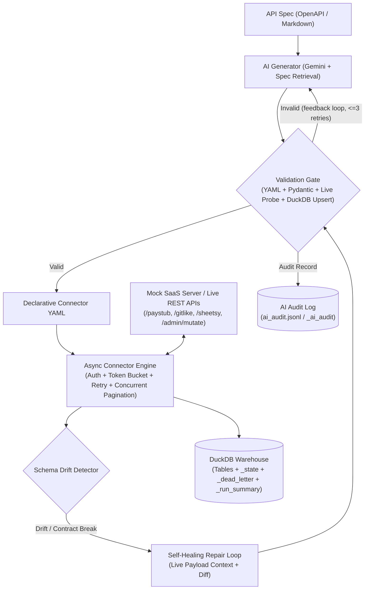

# Connector Platform

An async, config-driven SaaS data-connector engine paired with a **validation-gated LLM layer** for spec-to-config generation and self-healing schema drift repair.

Instead of asking an LLM to write arbitrary Python integration code, every connector is a declarative YAML contract validated by Pydantic v2 and executed by one deterministic async engine (`httpx` + `asyncio` + `DuckDB`). Any AI-generated or repaired YAML must pass syntax, schema, live HTTP dry-run probing, and in-memory DuckDB upsert checks before it is ever accepted.

## Architecture



## Core Features

- **Declarative YAML Schema (`connector.config`)**: Pydantic v2 validation for multi-stream connectors, SQL-safe identifiers, nested `records_path`, query params, `rate_limit`, and `max_concurrency`.
- **Auth (`connector.auth`)**: Custom API key headers, Bearer tokens, and OAuth2 refresh-token flows with automatic refresh on expiry or HTTP `401`.
- **Pagination (`connector.pagination`)**: Offset/limit (both known `total_path` and speculative concurrent windowing), cursor-based, and RFC 5988 `Link` header pagination behind one interface.
- **Resilience (`connector.retry`)**: Per-connector `TokenBucket` rate limiter + exponential backoff with jitter on `429`/`5xx` and `Retry-After` compliance.
- **Incremental State & Idempotent Warehouse (`connector.state`, `connector.destination`)**: Vectorized DuckDB `UNNEST` batch upserts, `_state` incremental bookmarks (never advanced on failure), `_dead_letter` quarantine for invalid records, and `_run_summary` metrics.
- **Validation-Gated AI Generation & Self-Healing (`connector.ai`)**: Spec chunking/retrieval for large OpenAPI docs, `GeminiLLMClient` (`GEMINI_API_KEY` + `GEMINI_MODEL`), live drift context inspection, unified YAML diffs, `--auto-apply` guardrails, and append-only audit logging.

## Quickstart (Local)

```bash
cd connector-platform
python -m venv .venv
source .venv/bin/activate
pip install -e ".[dev]"

cp .env.example .env
set -a && source .env && set +a
```

Start the FastAPI mock SaaS server in terminal 1:

```bash
uvicorn mock_server.app:app --host 127.0.0.1 --port 8000
```

Run connector commands in terminal 2:

```bash
# Validate a declarative config
connector validate paystub

# Sync into DuckDB (supports concurrent fetching + vectorized batch upserts)
connector run paystub --db data/warehouse.duckdb --concurrency 4 --batch-size 1000
connector run gitlike --db data/warehouse.duckdb
connector run sheetsy --db data/warehouse.duckdb

# Inspect live API schema drift without mutating data
connector drift-check paystub --fail-on-drift
```

## Docker Compose

Run the mock server and connector CLI together:

```bash
cd connector-platform
cp .env.example .env
docker compose up --build --abort-on-container-exit
```

Run custom CLI subcommands against the Compose stack:

```bash
docker compose up -d mock-server
docker compose run --rm connector validate gitlike
docker compose run --rm connector run sheetsy --db /app/data/connector.duckdb
docker compose down
```

## AI Spec Generation & Self-Healing CLI

Set `GEMINI_API_KEY` and `GEMINI_MODEL` (defaults to `gemini-4-hydrogen`):

```bash
# Generate and validate a connector config from an OpenAPI or Markdown spec
connector generate path/to/openapi.json \
  --name paystub \
  --base-url http://localhost:8000/paystub \
  --stream charges \
  --output connectors/paystub_generated.yaml

# Simulate breaking API drift on the mock server
curl -X POST http://localhost:8000/admin/mutate \
  -H "Content-Type: application/json" \
  -d '{"service":"paystub","rename_fields":{"amount":"amount_cents"},"records_path":"payload.charges"}'

# Repair the connector config (dry-run diff by default; add --auto-apply to write)
connector repair paystub --error "records_path moved" --auto-apply
```

All generation and repair outcomes (accepted or rejected, attempts, unified diffs, and validation errors) are appended to `ai_audit.jsonl`.

## Benchmarks & Evaluation

### Throughput Benchmark (`benchmarks/bench_throughput.py`)

Measured on `100,000` records (`500` records/page, `50 ms` simulated API latency per request):

| Scenario | Concurrency | Batch Size | Pooling | Loaded Rows | Retries | Duration | Throughput |
| --- | ---: | ---: | --- | ---: | ---: | ---: | ---: |
| `baseline_sequential` | 1 | 500 | False | 100,000 | 0 | 15.61 s | 6,407.17 rec/s |
| `concurrency_8` | 8 | 1000 | True | 100,000 | 0 | 4.33 s | 23,082.19 rec/s |
| `batch_5000` (optimized) | 16 | 5000 | True | 100,000 | 0 | 3.83 s | **26,091.28 rec/s (4.07x)** |
| `faults_5pct429_2pct500` | 16 | 1000 | True | 100,000 | 15 | 4.65 s | 21,526.12 rec/s |

Re-run the throughput benchmark:

```bash
python -m benchmarks.bench_throughput
```

### AI Layer Evaluation (`benchmarks/eval_ai_layer.py`)

Evaluated across **24 scenarios** (`6` OpenAPI/Markdown generation scenarios + `18` mutation/repair scenarios covering field renames, breaking type changes, additions/removals, nested `records_path` shifts, query parameter renames, and adversarial invalid cases):

| Metric | Measured Result |
| --- | --- |
| Total Scenarios | 24 (`benchmarks/results.md`) |
| Generation First-Attempt Pass Rate | 60.0% |
| Generation Pass@3 Rate | 100.0% |
| Repair Success Rate (within 3 retries + full sync) | 100.0% |
| Validation Gate Catch Rate (adversarial/broken configs) | 100.0% |
| Mean Latency per Scenario | 171.12 ms |

Re-run the AI evaluation harness:

```bash
python -m benchmarks.eval_ai_layer
```

## Testing

```bash
pytest -v --cov=connector --cov-report=term-missing
```
